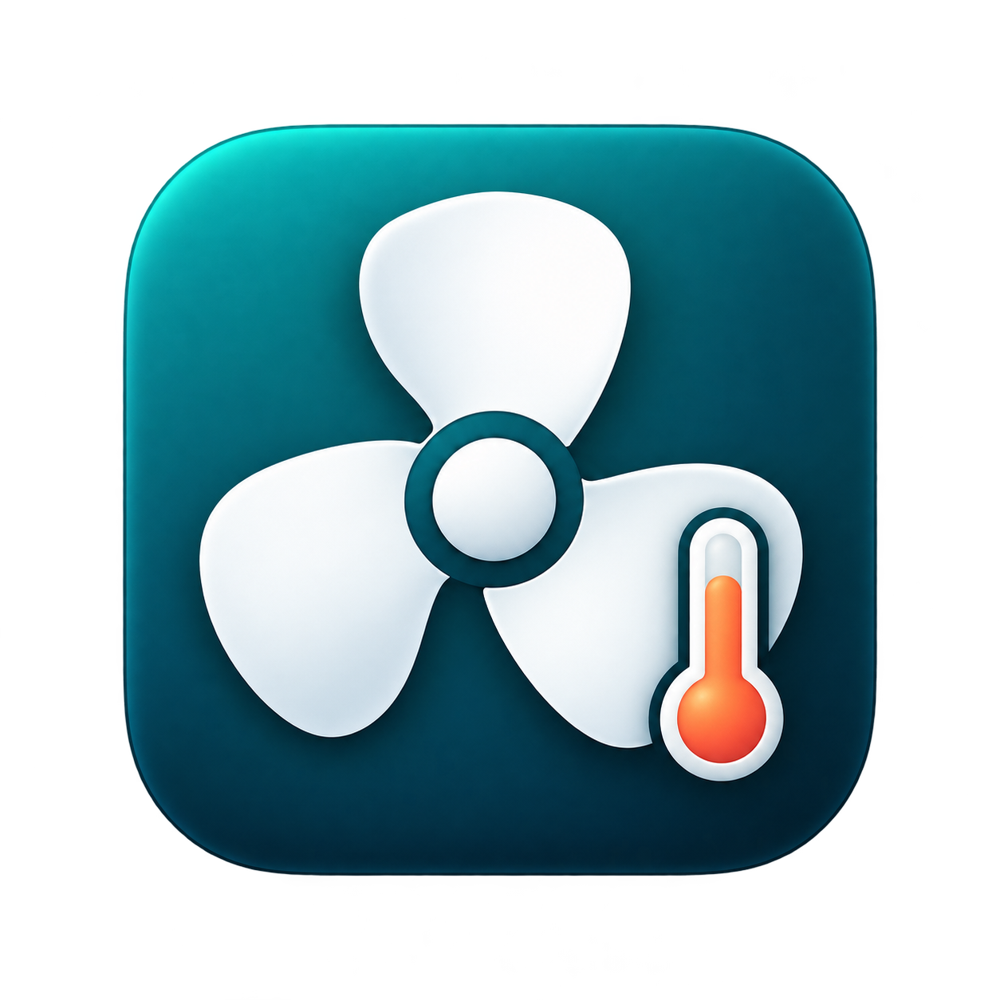

# MiniThermal

English · [简体中文](README.zh-CN.md)

A native macOS menu bar utility for temperature monitoring and experimental fan control on the **M4 Mac mini (Mac16,10)**. Built with Swift, SwiftUI, AppKit and a small C interface to AppleSMC. The current app interface is in Simplified Chinese.

<p align="center"></p>

[Download](https://github.com/RTXDF/MiniThermal/releases/latest) · [Report an issue](https://github.com/RTXDF/MiniThermal/issues) · [Contribute](CONTRIBUTING.md) · [MIT license](LICENSE)

## What it does

- Shows the highest identified CPU and GPU sensor temperatures, actual fan speed, and a two-minute temperature history.
- Reads the firmware's fan-speed limits and offers a target RPM slider after administrator authorization.
- Provides a return-to-system-automatic action, temperature-dependent minimum speeds, and a separate recovery process for helper failures.
- Supports login at startup, an expandable sensor list, and CSV export of the current readings.

Temperature and RPM readings are obtained locally. Monitoring requires no administrator authorization. Manual control uses a temporary privileged helper started through the macOS authorization dialog; the app does not collect or store the administrator password.

## Compatibility and validation

| Item | Current status |
| --- | --- |
| Target hardware | M4 Mac mini, model identifier `Mac16,10` |
| Deployment target | macOS 14 or later, Apple Silicon |
| Recorded on-device testing | M4 Mac mini on macOS 27.0.1 |
| Temperature and RPM reads | Verified on the target machine |
| Automated coverage | 74 simulated SMC checks, plus instance-lock checks |
| Privileged writes and sleep/wake recovery | Full on-device validation remains pending |
| Other Mac models | Unsupported; the control helper rejects other model identifiers |

**Manual fan control is experimental.** Simulated checks do not establish firmware behavior or reliable recovery on real hardware. The project records what was tested and what remains unverified in [VALIDATION.md](VALIDATION.md) (Chinese). The deployment target is not a claim that every macOS release or Apple Silicon model has been tested.

## Install

1. Download `MiniThermal.zip` from the [latest release](https://github.com/RTXDF/MiniThermal/releases/latest).
2. Extract it and put `MiniThermal.app` in `~/Applications`.
3. Open the app, then click the fan icon in the menu bar.

Published builds use a local ad hoc signature. They are not Developer ID signed or notarized, so macOS may block a downloaded build. Building from the inspectable source is also supported.

When upgrading from v1.0.3 or earlier, turn off **登录时启动** (Launch at login) in the old version and quit it before replacing the app. Enable it again in the new version if needed. v1.0.4 changed the bundle identifier to fix a persistent Spotlight placeholder icon.

## Use

The menu bar displays the highest identified chip temperature. The panel separates the requested target from the actual fan speed.

| App label | Action |
| --- | --- |
| 启用调速… | Enable fan control through the macOS administrator authorization dialog |
| 应用转速 | Apply the selected RPM |
| 恢复系统自动 | Return control to macOS |
| 登录时启动 | Enable launch at login |

Firmware reported a range of **1000–4900 RPM** on the test machine; the app reads the range rather than assuming these values. Manual settings last only for the current app session and are not automatically reapplied after relaunch.

Only identified M4 temperature channels are displayed. CPU and GPU cards show the maximum reading in each group, not an average; this avoids treating unrelated calibration values as temperatures.

## Control and recovery behavior

- Requested RPM must be within the firmware's reported range.
- Above 50°C, the helper progressively raises the permitted minimum RPM; at 80°C, it requires the firmware maximum. The effective target can therefore exceed the slider value.
- At 95°C, missing CPU/GPU readings, firmware takeover, or a critical macOS thermal state, the app stops manual control and attempts to restore system automatic control.
- App exit, sleep, user-session changes, client disconnection and expired heartbeats trigger restoration attempts. A separate guard process also attempts recovery if the helper is killed. Failed writes are retried and reported.

These are application-level recovery mechanisms, not a guarantee against operating-system failure, power loss, or simultaneous termination of both helper processes. No persistent system daemon or kernel extension is installed, and SIP need not be disabled.

## Build and check

You need an Apple Silicon Mac, macOS 14 or later, Python 3, and full Xcode with its developer tools selected. The icon asset catalog is compiled with `actool`.

```sh
git clone https://github.com/RTXDF/MiniThermal.git
cd MiniThermal
zsh scripts/build.sh
```

The app is created at `build/MiniThermal.app`. The build compiles C with strict warnings, compiles Swift, packages both licenses, applies ad hoc signatures, and checks that the declared app icon can be loaded.

Run the simulated checks:

```sh
zsh scripts/test.sh
```

The suite uses simulated hardware and does not modify the real fan. It covers numeric encoding, bounds, M4 mode handling, thermal behavior, sensor failure, client disconnect, helper termination, heartbeat expiration and restoration. Instance-lock checks cover startup, restart, duplicate prevention, legacy permissions and symlink rejection.

For a read-only hardware report on a supported machine:

```sh
build/MiniThermal.app/Contents/MacOS/MiniThermal --diagnose
```

Review diagnostic output before posting it publicly. Report hardware model and macOS version alongside any compatibility claim.

## Contribute and next steps

Bug reports, documentation, translations and focused pull requests are welcome. Start with [CONTRIBUTING.md](CONTRIBUTING.md). Near-term priorities are to:

- Record controlled, on-device validation of privileged writes and sleep/wake recovery on the target M4 model.
- Collect read-only evidence for other hardware before considering support for additional models.
- Add English app localization and improve installation and release documentation.
- Review the helper's authorization, IPC and recovery paths, with reproducible regression checks for changes.

This is an early project. The roadmap describes planned work rather than completed validation or promised release dates.

## Uninstall

Turn off **登录时启动** (Launch at login), choose **恢复系统自动** (Return to system automatic), and quit. Then remove `~/Applications/MiniThermal.app`. The temporary helper processes terminate when the control session ends.

## License and acknowledgments

MiniThermal is licensed under the [MIT License](LICENSE), copyright 2026 RTXDF. Third-party notices are preserved in [THIRD_PARTY_NOTICES.md](THIRD_PARTY_NOTICES.md), including the full [Stats MIT license](References/Stats-LICENSE), which is also packaged with the app. The current flat app icon has an editable [SVG source](Assets/AppIcon.svg) and a native rendering script; see [the design notes](Assets/ICON_DESIGN.md).
